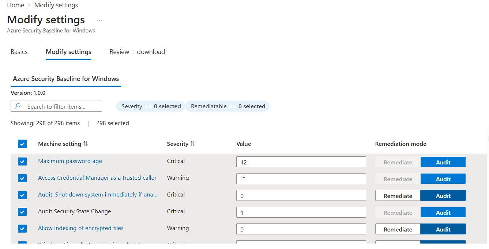
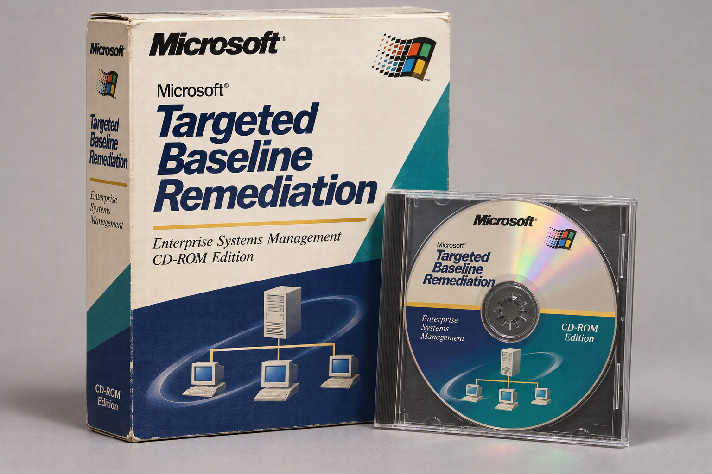
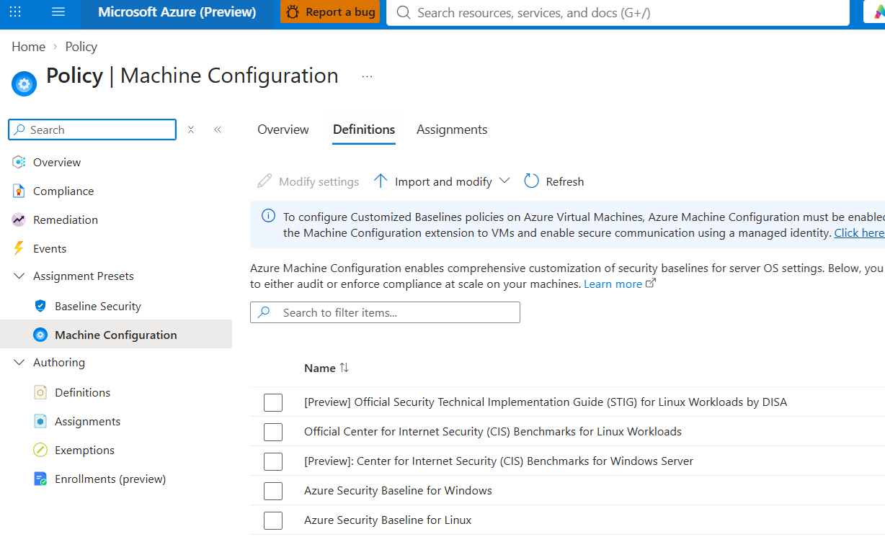
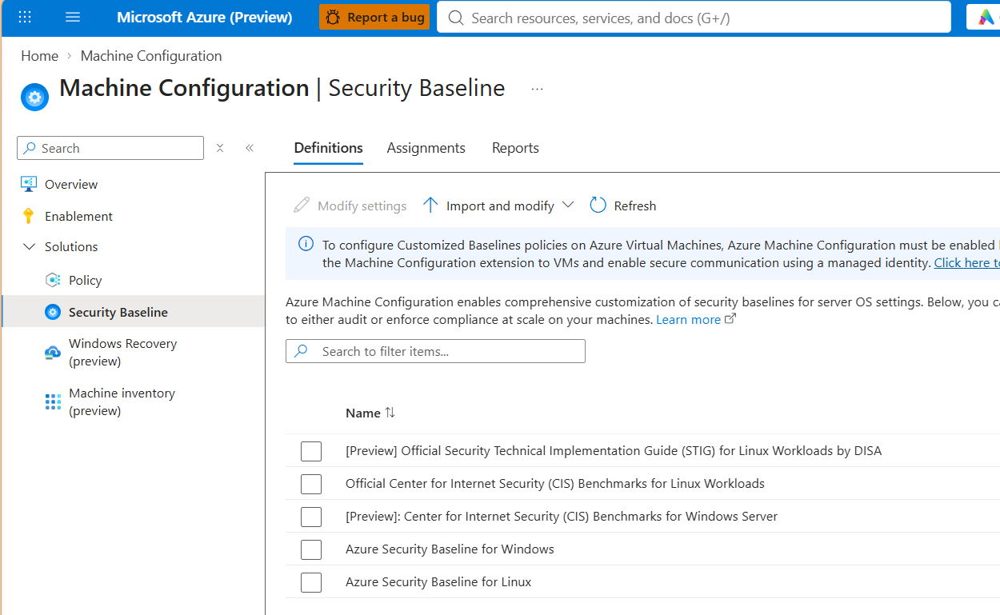
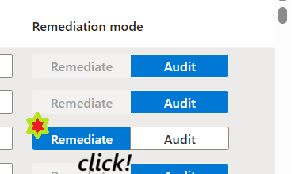
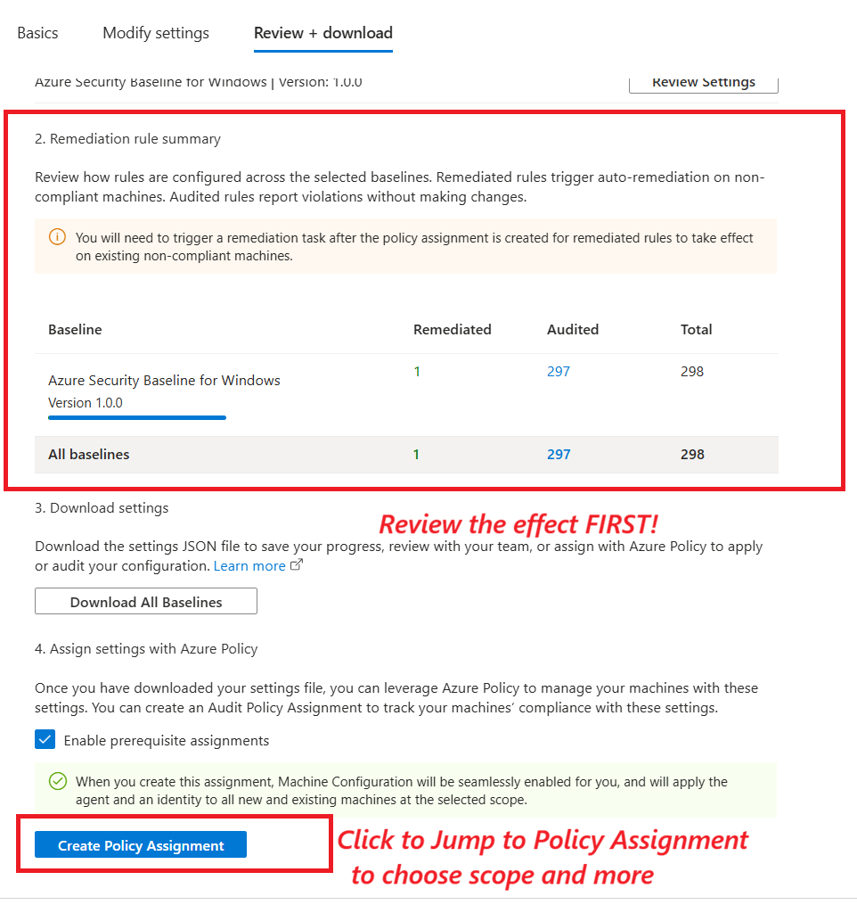
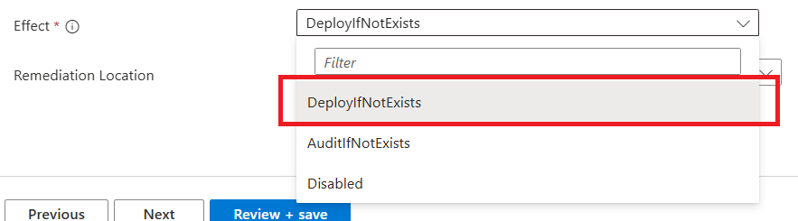
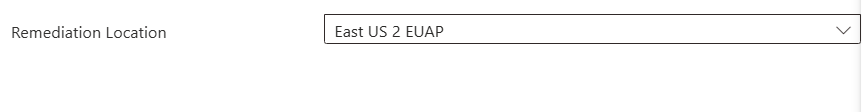
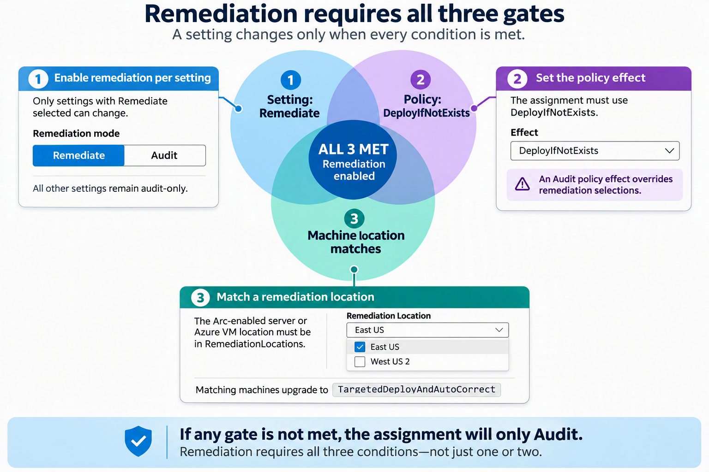

## Baseline Compliance at Scale

This area has long been my bread-and-butter, even back into my helpdesk and consulting days, helping organizations manage and get on top of their compliance.  There was a somewhat little known product known as the [Microsoft Security Compliance Toolkit (SCT)](https://learn.microsoft.com/en-us/windows/security/operating-system-security/device-management/windows-security-configuration-framework/security-compliance-toolkit-10).

For a few years, my day job revolved around helping companies in implementing these Group Policy recommendations.  Then Azure came out.  

And it had something called Azure Policy, but that didn't work the same way as, or cover the things you could do with Group Policy.  At least...not until now.

Years of experience working in the trenches, doing this the right way for customers and now, imagine my joy when I was asked to work on enabling Baselines natively in Azure Policy.

## Baseline Customization
 We called it Baseline Settings Customization, and we shipped it Public Preview at Ignite 2025 then GA'd it in May of 2026.

 

We covered ASB Windows and Linux and also CIS Linux.  Something like 3,000 plus unique settings.

Not only did we release it at Ignite, but I got to be there, in the labs and show it off, then meet the customers face to face.

**I was happy about it, surely users would love it too...right?**

But instead, they asked me

> OK, how do I actually get my machines into compliance?  Do you want me to use a different tool?  Why didn't you think of this obvious problem?! Actually since you're here, let me unload all of my years of grievances upon you...hey, come back here!

The experience stuck with me as I ran down the hall and made a quick escape, so we decided to do something about it.

# Baseline Remediation, what's in the box?

You know every scenario we already covered, like:

* Azure Security Baseline for Linux
* Azure Security Baseline for Windows
* CIS Benchmark for 18 Linux Distros

Well we have enabled Remdiation for all of them.  More than 1,600 settings support configuration on day one this week!  

You no longer need to roll your own solution to fix deviations, or use multiple products, it's all here, in the box in Machine Configuration.

Oh yeah, we also have added these two new scenarios as well!

* DISA STIG Baseline
* CIS for Windows!

Here's the [official announcement / docs](https://learn.microsoft.com/en-us/azure/governance/machine-configuration/how-to/assign-security-baselines/remediate-security-baselines) 

## How do I do this?

It's easy!  Go to our brand new Machine Configuration blade in the Azure Portal

Or find us on our forever home in the Policy Authoring blade

  

Next, pick a few settings and provide your customized values.  If you don't make any changes, you'll be applying the recommended default values from STIG, CIS or Azure Security team.

 

Make sure to toggle a few settings into Remediate mode.  That will apply those specific settings in Remediation capacity.

 

Now, let's use our eyes and brains and REVIEW the effect of the change we're about to apply.

Final step is applying the policy, where we need to do two things

## Getting the Assignment Right

When assigning the policy, be sure to chose the effect of `DeployIfNotExists` to enable a Remediation Assignment.

If you leave Remediation Location blank, we will only ever Audit this assignment.

## Some Tips and tricks

1. Make sure your machines are using the newest version the MC Agent, the October releases included the new feature
- Don't worry if you're on older versions of the agent, they will 'downgrade' and only audit against your customizations
2. Be sure you toggle the Mode of one of more settings to Remediate.  Only those settings will be remediated.

## The Three Pillars of Remediation

One thing I anticipate people might have questions about is how it is determined what should remediate and where.  

Remediation is Gated behind three things.

1. **Only Certain Settings** - Settings with 'Remediation' selected will make changes, all others will Audit only
2. **Only with the right Policy Effect** - If the Policy is assigned as 'Audit' this selection WINs.  The policy assignment must be deployed in DeployIfNotExists to enable any Remediation at all
3. **Only for the right locations** We are introducing a new idea of RemediationLocations.  The user provides a RemediationLocation list, ARC devices or VMs with locations in that location will upgrade their assignment to `TargetedDeployAndAutoCorrect` mode.  

### Example

VmName | Vm Location
--|--
VM-EastUs01 | EastUS
VM-WestEurope01 | WestEurope

User selects remediation locations of `['WestEurope`]

VmName | Vm Location  | Resulting Assignment Type
--|--|--
VM-EastUs01 | EastUS | AuditOnly
VM-WestEurope01 | WestEurope | TargetedDeployAndAutoCorrect

You know how in Name of the Wind, Grief is escaped when you pass through all three doors?  Well in Machine Config, Remediation is only achieved when you meet all three gates

## Why did you add this RemediationLocation thing?

Imagine this scenario.  A customer assigns the policy in DINE with a few settings enabled.  Then later, the customer adds a few new ARC devices.

These devices might be Server '97 Exchange Mailbox hosts or something, truly ancient devices, but from an Azure Perspective, this is a 'new' machine, so it would end up skipping the normal Remdiation flow where a device must run an assignment in audit mode, then manually be 'upgraded' to set by means of creating running a remediation Task.  This is the way the Policy treats 'new' machines, even if it is a new old machine.  

I needed to engineer a quality gate here to allow customers to add new devices in scope, but to not have them immediately start remediating everything.  

For this reason, we added this concept of a RemediationLocation.  This puts customers in charge as to which devices are in scope for a write capable device.

In this case, a customer could empty their remediationLocations and any net new devices would safely Audit only.  Keep in mind, this would not reflect to devices already in remediation.

## What if I get it wrong?

We tried to be very thoughtful here, and for every 'off the rails' type of scenario we could think of, we added some safety measures to prevent problems. For instance:

* If you assign and pick all defaults but do not set *any* mode properties...we'll ensure it still Audits
* You forget to upgrade your agent to a version that supports this new mode...it will downgrade to Auditing

## New Feature, New Type of Assignment

To recieve the new affect of TargetedRemediation, the resulting assignment must be `TargetedDeployAndAutoCorrect`.  If you are experimenting and create an assignment in the legayc `DeployAndAutoCorrect` mode, this **will not** apply TargetedRemediation logic, and is not supported or recommended. 

It is **not** recommended to manually craft an assignment for a baseline scenario with an assignmentType of `DeployAndAutoCorrect`, use the new assignmentType of `TargetedDeployAndAutoCorrect`

## Bonus Section, how we got here

As for what's next for this area?  Time will tell.  Until then, send me your ideas here, on Github, or at reddit.com/r/FoxDeploy

Still reading?  Here's a bit of info as to how the product evolved and grew

# Why are you trying to solve this problem?  Also, what happened to you?

You may not know this but before I did speaking, and was a blogger, and worked at #BigBank, or spent years with a blue badge...I worked in the Active Directory space helping customers manage their Windows Images and especially deploying a somewhat little known thing called the Group Policy Baselines.

One specific tool was called the Microsoft Security Compliance Manager (or SCM...we LOVE calling things Configuration or Compliance Manager here), the most compelling feature of which was a little set of preconfigured Group Policies you could import, called the Microsoft Group Policy Baselines.  These contained an opinionated list of settings that you should be enforcing or at least auditing in your environment to acheive a 'well-managed' corporate image.

Tools like these grew and eventually informed other opionated management platform moves, like the 'Cloud Adoption Framework' which informed the decisions we made in the first product I worked on which was called, 'Azure Automanage'.

## It was a tool called policy, but not like you think

I remember great excitement when Azure Policy was announced, we all immediately assumed it would be a cloud based extension of Group Policy.  Turns out it was more a governance play than anything to do with Machine Configuration.  Some of us were bummed by this.

In fact, years before I ever worked there, I once asked this very question on a Meet the Customer style phone call:

> Why is it called Policy if it cannot make changes to my VMs?  Policy has one meaning in Microsoft and it's Group Policy which does let me do that

And this was before ARC so I couldn't even manage my on-prem devices in Azure at all!  Eventually we got to preview a tool called InGuest Policy, later known as Guest Configuration, which let you assign a Policy a-la Group Policy and have it make changes to your devices.

But the issue was how to do this.  The Microsoft AD Baselines had ~300 or so settings.  However Azure Policy only seemed to let you configure ~15 settings per policy assignment, so the Baseline itself had twenty or more policies you needed to assign.  That's a LOT of different places to look for overall compliance. 

This was the kind of problem that basically always annoyed me.

Some adept users did write their own workarounds, making custom Azure Policies with custom packages, and baking their settings into them, but this was not friendly or easy to use for the average user.

This line of thinking lead to us engineering the Baseline Settings Catalog and from there, it's just been evolutionary incremental improvement.

Hope you liked this peek behind the curtain!